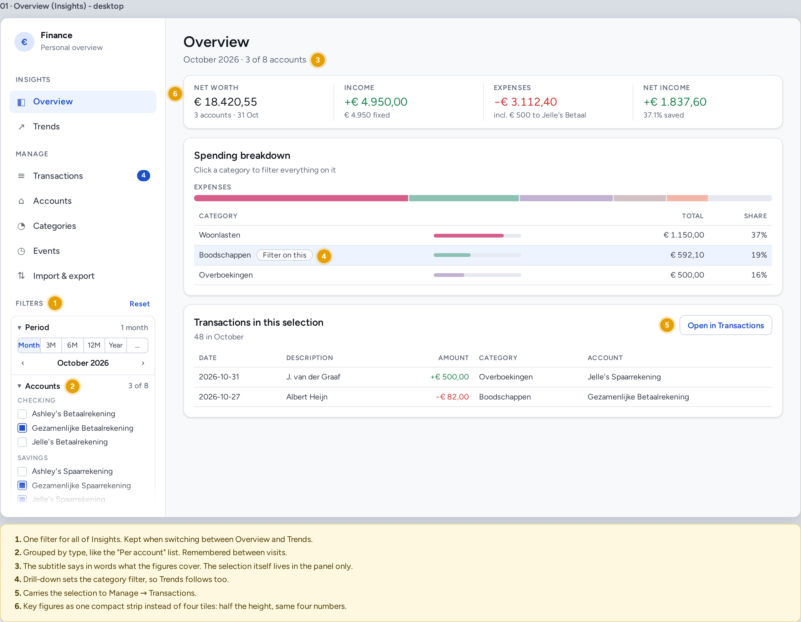
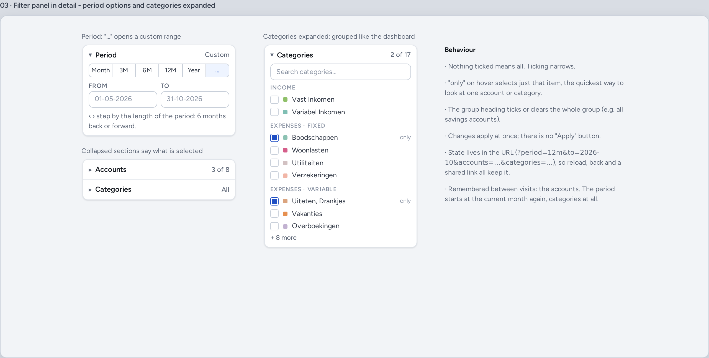
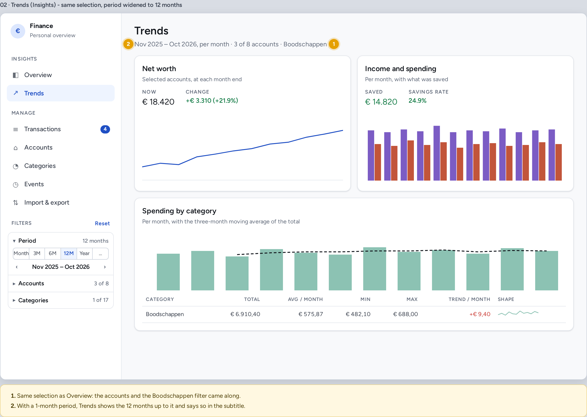
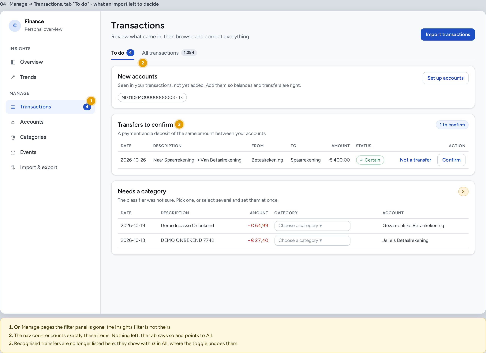
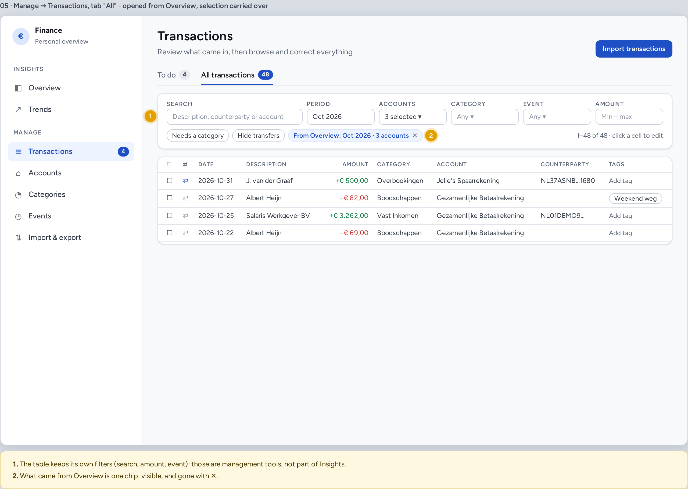
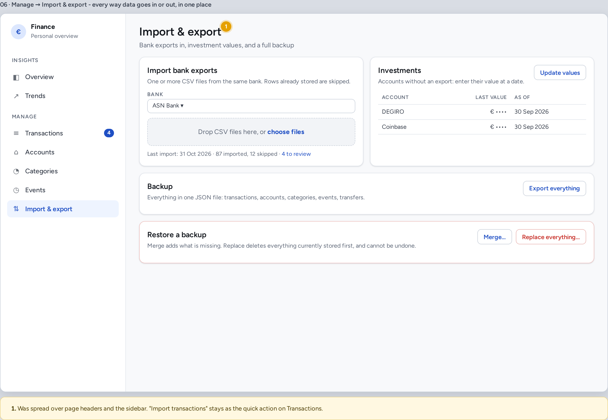
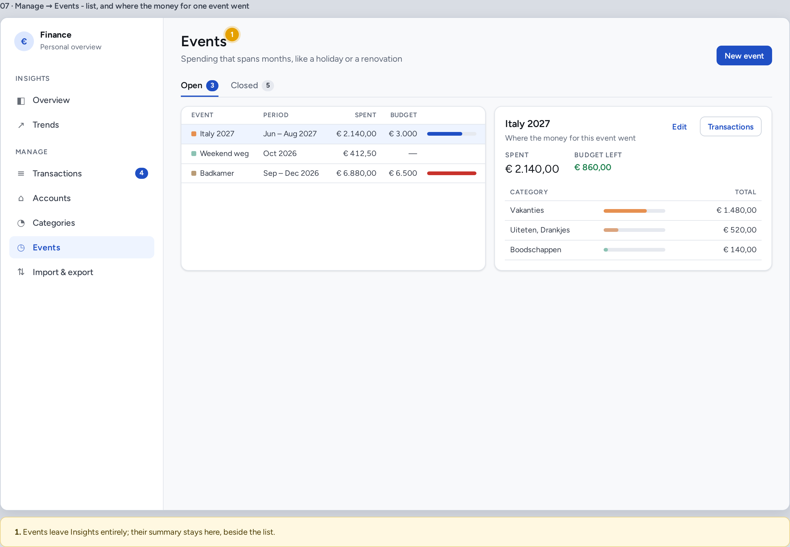
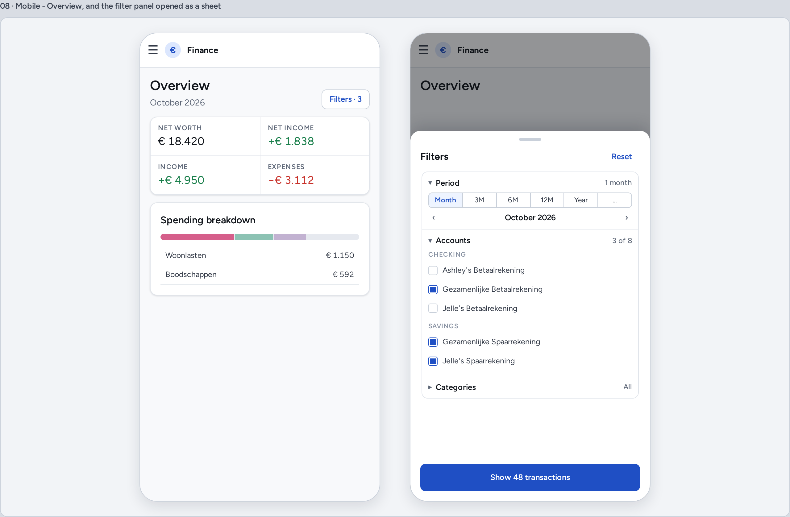

# Ontwerp: navigatie en filters

Status: **akkoord**, gebouwd in één PR naar `main` en uitgebracht als 2.0.0.
Wireframes: [`wireframes.html`](wireframes.html) (bron) en de afbeeldingen in [`img/`](img/).

## Waarom

De app is feature voor feature gegroeid, en elke feature kreeg een eigen filter op een eigen pagina:

| Pagina | Doel | Eigen filters |
|---|---|---|
| Dashboard | Inzicht: wat gebeurde er in een maand | Maandkiezer, rekening-chips (onthouden), categorie aanklikken voor de drill-down |
| Reports | Inzicht: hoe ontwikkelt het zich | Periode (6/12/24 mnd, dit jaar, eigen), categorie-chips, geen rekeningfilter |
| Events | Half inzicht, half beheer | Geen |
| Transactions | Na de import nakijken, zoeken en bewerken door elkaar | Eigen filterbalk met tien velden |
| Accounts, Categories | Basisgegevens beheren | Geen |

Wat daaruit volgt:

1. **Twee tijdmodellen.** Het dashboard denkt in één maand, Reports in een periode, en ze delen niets. Wie van pagina wisselt, is zijn selectie kwijt.
2. **Hetzelfde begrip op vier manieren.** Rekeningen zijn chips op het dashboard en een dropdown bij Transactions. Categorieën zijn chips bij Reports en een dropdown bij Transactions.
3. **Nakijken na een import zit verstopt in Transactions.** De kaart "nieuwe rekeningen" staat dubbel, op Transactions en op Accounts.
4. **Import en export zijn verspreid** over paginakoppen en de sidebar.

## Uitgangspunten

- **Twee zones.** *Insights* is analyseren: alleen lezen, filterbaar. *Manage* is gegevens bijhouden: invoeren, corrigeren, inrichten.
- **Eén filter voor heel Insights.** Overview en Trends tonen dezelfde selectie. Wisselen tussen de twee houdt de selectie vast.
- **Filters staan vast in beeld,** in de linkerbalk. Boven de inhoud staat geen filterregel; de ondertitel zegt in woorden waar de cijfers over gaan.
- **Eén begrip, één bediening.** Rekeningen en categorieën kies je overal op dezelfde manier.
- **Eén major release: 2.0.0.** Alles komt in één keer uit en vervangt 1.x (zie *Werkwijze en release*).

## Navigatie

| Nu | Wordt | Zone |
|---|---|---|
| Dashboard | **Overview** | Insights |
| Reports | **Trends** | Insights |
| Transactions | **Transactions**, met tabs *To do* en *All* | Manage |
| Accounts | **Accounts** (ongewijzigd) | Manage |
| Categories | **Categories** | Manage |
| Events | **Events**, met de analyse per event erbij | Manage |
| Import in paginakoppen, export en restore in de sidebar | **Import & export** | Manage |

De sidebar toont eerst de twee navigatiegroepen en daaronder, alleen op Insights-pagina's, het filterpaneel met een eigen scrollbalk. Zo blijft de navigatie altijd zichtbaar, hoe ver je de filters ook uitklapt.

## Het filter

### Dimensies

| Dimensie | Bediening | Standaard | Onthouden tussen bezoeken |
|---|---|---|---|
| **Periode** | Month, 3M, 6M, 12M, Year, of "…" voor een eigen periode. Met ‹ › stap je per periodelengte. | Deze maand | Nee, elk bezoek begint bij deze maand |
| **Rekeningen** | Vinkjes, gegroepeerd per soort (Checking, Savings, Investments) | Alle | **Ja** |
| **Categorieën** | Vinkjes, gegroepeerd in inkomsten en uitgaven (vast/variabel), met zoekveld | Alle | Nee |

Events zitten niet in het filter: die gaan volledig naar Manage (zie hieronder).

### Gedrag

- Niets aangevinkt betekent alles. Aanvinken maakt de selectie kleiner.
- **"only"** (bij hover) kiest alleen dat ene item. Dat is de snelste manier om één rekening of categorie te bekijken.
- Een groepskop vinkt de hele groep aan of uit, bijvoorbeeld alle spaarrekeningen.
- Wijzigingen werken meteen. Er is geen knop "Toepassen".
- Ingeklapte secties laten zien wat er gekozen is ("3 of 8", "All").
- **De staat staat in de URL** (`?period=12m&to=2026-10&accounts=…&categories=…`). Herladen, de terugknop en een gedeelde link houden de selectie vast. De rekeningen staan daarnaast in `localStorage`.
- **Ondertitel** van de pagina zegt in woorden wat de cijfers beslaan: "October 2026 · 3 of 8 accounts · Boodschappen". Een aparte filterregel boven de inhoud is er niet; het paneel is de plek om te kiezen en te wissen.

### Wat volgt de selectie

| Cijfer | Periode | Rekeningen | Categorieën |
|---|---|---|---|
| Vermogen | Stand aan het einde van de periode | ✓ | – (een saldo heeft geen categorie) |
| Inkomsten, uitgaven, gespaard | ✓ | ✓ | ✓ |
| Uitgavenverdeling | ✓ | ✓ | ✓ |
| Transacties in de selectie | ✓ | ✓ | ✓ |
| Trends: vermogen, cashflow, per categorie | ✓ | ✓ | ✓ (vermogen –) |

**Overboekingen.** Dezelfde regel als de rekeningfilter van het dashboard nu al heeft (sinds 1.3.0), voortaan overal:
- Een overboeking tussen twee geselecteerde rekeningen telt niet mee.
- Een overboeking naar of van een rekening buiten de selectie telt als geld uit of in.

### Periodemodel

- **Overview** toont de **totalen** over de periode. Eén maand geeft het huidige dashboard; 12 maanden geeft jaartotalen.
- **Trends** toont **dezelfde periode per maand**.
- Bij een periode van één maand valt er per maand niets te zien. Trends toont dan de 12 maanden tot en met die maand en zegt dat in de kop. Zo kom je bij het wisselen nooit op een lege pagina uit.

### Kerncijfers

De vier kerncijfers van Overview (vermogen, inkomsten, uitgaven, netto) staan in **één compacte strook** in plaats van vier tegels: de vier cijfers naast elkaar, gescheiden door een dunne lijn, met een regel toelichting eronder. Ongeveer de helft van de hoogte, zodat de uitgavenverdeling hoger op de pagina begint. Op mobiel wordt het een blok van 2×2.

### Drill-down

- Een klik op een categorie in de uitgavenverdeling **zet die categorie in het filter**. Er gaat geen los paneel open, dus Trends volgt ook.
- **"Open in Transactions"** neemt de selectie mee naar Manage, als één chip ("From Overview: Oct 2026 · 3 accounts ✕") boven de eigen filters van de tabel.

## Manage

### Transactions

**To do:** alles wat een import te beslissen overlaat, op één plek:
- nieuwe rekeningen;
- overboekingen om te bevestigen;
- transacties zonder categorie.

De teller in het menu telt precies deze punten. Is alles af, dan zegt de tab dat en wijst hij naar *All*.

**All:** zoeken en bewerken.
- De eigen filters blijven, want dit zijn beheergereedschappen: zoeken, bedrag, event, richting, "Needs a category", "Hide transfers".
- De ⇄-schakelaar per rij, de bulkacties en de tags blijven zoals in 1.4.0.

### Import & export

Elke manier waarop data binnenkomt of eruit gaat:
- bankexports (één of meer CSV's);
- waarden van beleggingen;
- volledige back-up;
- terugzetten van een back-up, met "Replace everything" in een gevarenzone volgens het instellingenpatroon uit de huisstijl.

"Import transactions" blijft als snelle actie in de kop van Transactions.

### Events

- Lijst met tabs *Open* en *Closed*: periode, uitgegeven, budget en voortgang.
- Daarnaast de analyse van het geselecteerde event: waar het geld naartoe ging, per categorie.
- Aanmaken en bewerken gebeuren hier ook.

### Accounts en Categories

Inhoudelijk ongewijzigd, als lijst in een kaart volgens het lijstpatroon. Accounts houdt de kaart "seen in your transactions, not yet added", want daar voeg je ze toe. *To do* meldt dezelfde rekeningen en verwijst met "Set up accounts" naar Accounts.

## Mobiel

- De navigatie blijft in de bestaande lade.
- Het filterpaneel wordt een knop **"Filters · 3"** naast de paginatitel. Die opent het paneel als sheet van onderen, met tikdoelen van minstens 44px en onderaan "Show 48 transactions".
- De knop zegt hoeveel filters er actief zijn; de ondertitel zegt welke periode.

## Afwijking van de huisstijl

De dataviz-richtlijn zegt: *filters in één rij boven de grafieken*. Met 8 rekeningen en 17 categorieën past dat niet meer in één rij; het werd een muur van chips. De filters staan daarom in het linkerpaneel, dat op Insights-pagina's altijd zichtbaar is. Wat er geselecteerd is, staat in woorden in de ondertitel van de pagina, zodat je ziet waar de cijfers over gaan zonder dat er een extra regel boven de inhoud staat.

## Gevolgen voor de API

| Endpoint | Nu | Nodig |
|---|---|---|
| `GET /category-sums` | `accounts` (met overboekingsregel) | `+ categories` |
| `GET /income-expenses-sum` | `accounts` (met overboekingsregel) | `+ categories` |
| `GET /account-overview` | – (client filtert) | ongewijzigd |
| `GET /net-worth-history` | – | `+ accounts` |
| `GET /reports/cashflow` | – | `+ accounts`, `+ categories`, overboekingsregel |
| `GET /reports/category-history` | `accounts`, `categories`, zonder overboekingsregel | overboekingsregel |
| `GET /transactions/search` | `accounts`, `categories`, met overboekingsregel | ongewijzigd |

Alles optioneel en achterwaarts compatibel: zonder parameter blijft het gedrag zoals nu. Er is geen schemawijziging nodig.

## Werkwijze en release: alles in 2.0.0

Alles hieronder komt in **één major release, 2.0.0**, die 1.x vervangt: een big bang.

- **Eén PR naar `main`** met alle stappen als losse commits, zodat elke stap in de geschiedenis te volgen is. Elke push zet de PR opnieuw op acc.
- **Release:** de PR bevat een commit met `Release-As: 2.0.0`. Na de merge maakt release-please de release-PR 2.0.0, en het mergen daarvan zet het in productie.

### Stappen

1. **Gedeelde filterstaat.**
   - Een `InsightsFilter`-context met de staat in de URL.
   - Rekeningen in `localStorage`, als vervanging van de huidige dashboardsleutel.
   - Op de server de parameters uit de tabel hierboven.
   - Dashboard en Reports lezen dezelfde selectie; hun eigen filters verdwijnen.
2. **Navigatie en filterpaneel.**
   - Sidebar met Insights en Manage, en het filterpaneel.
   - Mobiel: knop en sheet.
   - Dashboard en Reports heten voortaan Overview en Trends; oude URL's verwijzen door.
3. **Insights afmaken.**
   - Het periodemodel (totalen tegenover per maand).
   - De compacte kerncijfers.
   - Drill-down via het filter.
   - "Open in Transactions" met de meegenomen selectie.
4. **Manage opschonen.**
   - Transactions krijgt de tabs To do en All.
   - De pagina Import & export.
   - Events met de analyse erbij.
   - De dubbele kaart op Accounts verdwijnt.

## Besluiten

- **Inkomstencategorieën horen in het filter.** Wie alleen "Vast Inkomen" aanvinkt, ziet dan geen uitgaven; dat is consequent.
- **Geen event-filter in 2.0.** Events staan alleen onder Manage. Een event-filter kan later als vierde dimensie, als de vraag "hoeveel boodschappen tijdens de vakantie" terugkomt.
- **Labels blijven Engels**, zoals de rest van de app: Overview, Trends, Manage.
